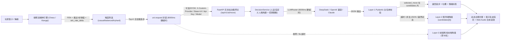

# 棋逢嘴手 · TrashTalk Chess

<p align="left">
  
  
  
  
  
</p>

**棋逢嘴手（TrashTalk Chess）** 是一款同时支持 **中国象棋（9×10）** 与 **国际象棋（8×8）** 的 **Neuro-Symbolic（神经-符号混合智能）** 拟人化博弈应用。

项目将「**端侧确定性 Alpha-Beta 算步引擎**」与「**云端多模型人格化决策吐槽**」解耦协同：前端零后端算力开销完成合法走法校验、Alpha-Beta 搜索与 Top-K 候选筛选；大模型仅在**合法候选白名单**内结合胜率波动、难度策略与角色人设挑选着法并飙出戏感十足的实时垃圾话，彻底消除大模型下出非法走法的幻觉问题。

---

## 核心架构



### 阶梯超时与三层容错设计
1. **Layer 1（输出白名单强校验）**：`LLMDecisionOutput` 利用 Pydantic 上下文强制校验 `selected_move ∈ candidates`，同时清洗并裁剪 `comment` 长度与合法 `emotion`。
2. **Layer 2（服务端网关 6s 熔断降级）**：上游超时或返回异常格式时，网关立即降级返回 `candidates[0]`（引擎最优步）与角色专属兜底台词，前端无感知流畅对弈。
3. **Layer 3（客户端 8s 本地兜底）**：即使后端未启动、网络断开或超出 `8000ms` 硬超时，前端直接读取 `candidates[0]` 并触发本地离线台词库，确保永不死锁。

---

## 核心亮点

- **双棋种完整规则与端侧引擎**：
  - **中国象棋**：9×10 棋盘、WXF FEN 解析与序列化、马腿/象眼限制、将帅照面禁手、长将/三次重复禁手与绝杀/困毙判定，支持标准中文纵线着法生成（如 `炮二平五`）。
  - **国际象棋**：8×8 棋盘、标准 FEN、王车易位（Castling）、吃过路兵（En Passant）、兵底线升变（`q/r/b/n`）、将军/逼和（Stalemate）完整实现。
- **局势自适应陪练与防跳变胜率条**：
  - `casual`（娱乐放水）采用 `depth = 2` 搜索与 `-40 ~ -130 cp` 温和次优步筛选，并在提示词中实现**局势自适应放水**（均势/占优偶露小破绽，明显劣势立即全力防守反击），告别无脑送子。
  - `evaluator.js` 与 `EvalBar.vue` 对必杀极值（`±29998 cp`）锁定胜率在 `0.1% ~ 99.9%`，彻底消除大优绝杀阶段胜率条回跳 `50.0%` 的异常。
- **零外部音频依赖的程序化音效系统**：
  - 基于 Web Audio API 实时合成清脆木质落子、厚重吃子、紧迫将军金属鸣响与胜负结束和弦（[sound.js](frontend/utils/sound.js)），兼容非浏览器环境安全降级，顶部状态栏支持一键静音持久化。
- **动态氛围视效与细节交互**：
  - 随对手 `theme_color` 实时变化的径向环境光晕、毛玻璃卡片层叠、檀木鎏金象棋盘与深胡桃木/象牙白国象盘。
  - **AI 落子轨迹高亮**（起点虚线残影 + 终点角标脉冲），以及每局 **2 次悔棋限制 + 角色专属悔棋嘲讽彩蛋**。
- **BYOK 多模型路由与自定义角色工坊**：
  - 首页右上角「**API 与模型设置**」支持一键切换 **服务端默认配置** / **自定义我的 API Key（BYOK）**，支持 DeepSeek、OpenAI 兼容（含自定义中转站 `Base URL`）与 Claude，并提供 **一键连通性测试**。
  - 密钥仅存本地存储并通过 `X-Custom-*` Header 无状态透传，后端日志与异常处理严格执行 `mask_secrets` 脱敏。
  - 内置 **角色工坊**：可自定义对手名称、主题色、性格描述与口头禅，保存后直接进入对战。

---

## 目录与文档索引

```text
TrashTalk-Chess/
├── README.md                       # 项目总览与快速启动文档
├── API_SPEC.md                     # 前后端 REST API 协议与错误码契约
├── PROJECT_STRUCTURE.md            # 工程目录结构与安全边界规范
├── .gitignore                      # 隔离 .env、.venv、node_modules、unpackage 等产物
├── backend/                        # Python FastAPI 无状态 AI 决策网关
│   ├── .env.example                # 后端环境变量示例模板（占位符）
│   ├── pyproject.toml              # 依赖与 pytest 配置
│   ├── requirements.txt
│   ├── app/
│   │   ├── api/v1/                 # /health、/personas、/ai/move、/ai/test-connection
│   │   ├── core/                   # Settings、统一异常与 SecretMaskingFilter 脱敏日志
│   │   ├── llm/                    # DeepSeek / OpenAI / Claude 异步适配器与路由
│   │   ├── personas/               # 预置角色配置与动态 Prompt 构建器
│   │   ├── schemas/                # Pydantic v2 请求/响应/白名单强校验模型
│   │   └── services/               # DecisionService 编排与降级兜底
│   └── tests/                      # 22 项 pytest 契约、容错与 BYOK 单测
└── frontend/                       # uni-app (Vue 3) 跨端前端工程
    ├── api/                        # request.js 与 ai.js（含 Header 透传与本地兜底）
    ├── components/                 # 双棋盘、吐槽气泡、胜率条、角色选择、设置与角色工坊弹窗
    ├── config/                     # 环境配置与难度/台词常量
    ├── engine/                     # 纯 JS 双棋种规则校验、Alpha-Beta 搜索与胜率评估
    ├── pages/                      # index（开局配置）与 battle（对弈主界面）
    ├── stores/                     # game / persona / settings 响应式状态管理
    ├── utils/                      # Web Audio 程序化音效与主题色工具
    └── tests/                      # 22 项 Node 原生引擎、商店与 BYOK 单测
```

---

## 快速启动

### 1. 启动后端网关（FastAPI）

需要 **Python 3.11+**。

```bash
cd backend

# 1. 创建并激活虚拟环境
python -m venv .venv
# Windows PowerShell:
.venv\Scripts\Activate.ps1
# macOS / Linux:
# source .venv/bin/activate

# 2. 安装依赖
pip install -r requirements.txt

# 3. 初始化环境变量（填入你的 API Key；若仅使用前端 BYOK 模式也可留空）
cp .env.example .env

# 4. 启动本地开发服务器（默认监听 http://127.0.0.1:8000）
uvicorn app.main:app --host 0.0.0.0 --port 8000 --reload
```

启动后可访问交互式文档确认服务状态：
- 健康检查：`GET http://127.0.0.1:8000/api/v1/health`
- Swagger 文档：`http://127.0.0.1:8000/docs`

### 2. 启动前端应用（HBuilderX / 浏览器 / 微信小程序）

frontend 为标准 `uni-app`（Vue 3）工程，默认请求 `http://127.0.0.1:8000/api/v1`（App 模拟器自动适配 `10.0.2.2:8000`，见 [frontend/config/env.js](frontend/config/env.js)）：

1. 使用 **HBuilderX** 打开 `frontend/` 目录。
2. 选择菜单栏 **运行 -> 运行到浏览器**（体验完整 Web Audio 音效与响应式大屏棋盘），或 **运行 -> 运行到小程序模拟器 -> 微信开发者工具**。
3. （可选）如果后端 `.env` 未配置密钥，直接在前端首页右上角点击 **「API 与模型设置」**，切换为 **「自定义我的 API Key」**，填写模型厂商、中转站 Base URL、API Key 与模型名，点击 **「测试连通性」** 验证即可开始对弈。

---

## 自动化测试

前后端共包含 **44 项自动化单元测试**，覆盖棋规引擎、Alpha-Beta 搜索性能、候选筛选、胜率连续性、多模型适配、三层降级容错、BYOK 请求头透传与密钥日志脱敏：

```bash
# 运行后端测试（22 passed）
cd backend
.venv\Scripts\python.exe -m pytest -v

# 运行前端测试（22 passed）
cd ../frontend
npm test
```

---

## 安全说明

- `backend/.env`、虚拟环境、构建产物（`frontend/unpackage/`、`node_modules/`、`__pycache__/`）均已在 `.gitignore` 中严格隔离。
- BYOK 模式下用户的 `API Key` 仅保存在客户端本地缓存中，通过 `X-Custom-Api-Key` 请求头单次透传至无状态网关后直接转发上游模型接口；后端不落盘存储，且日志过滤器自动将其脱敏为 `***REDACTED***`。
